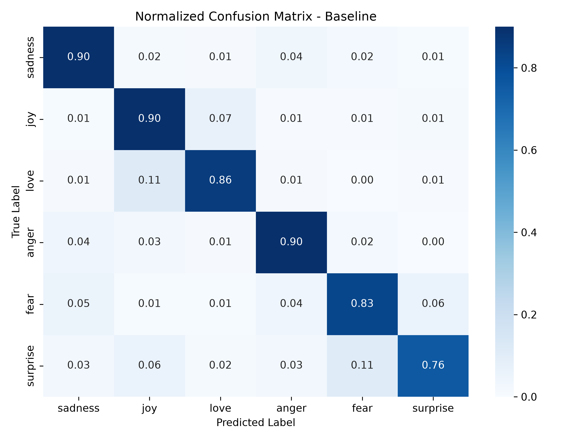
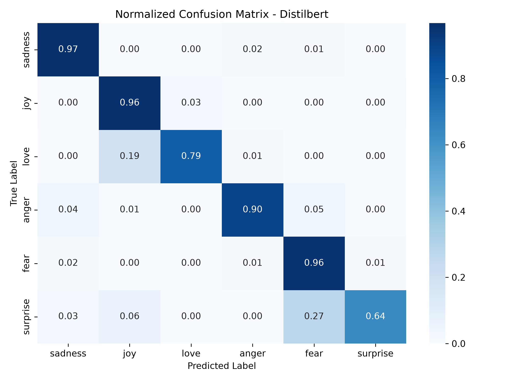
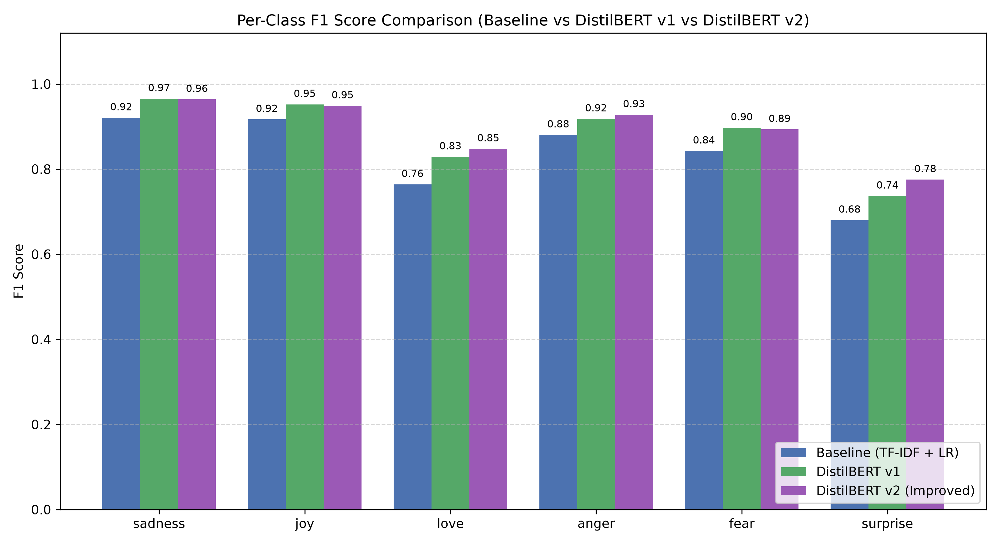
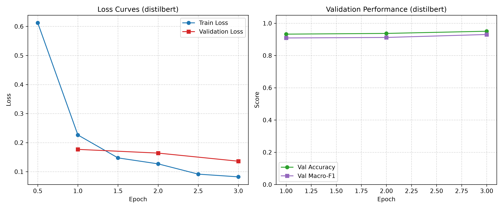

# 🎭 Emotion Detection in Text: Classical NLP vs. Transformer Architecture with Explainable AI

[](https://www.python.org/downloads/)
[](https://opensource.org/licenses/MIT)
[](https://streamlit.io/)
[](https://huggingface.co/datasets/dair-ai/emotion)

---

## ⚡ Quick start (for evaluators)

### Mac / Linux
```bash
git clone https://github.com/DakshSajwan/emotion-nlp.git
cd emotion-nlp
python3 -m venv .venv
source .venv/bin/activate
python -m pip install --upgrade pip
pip install -r requirements.txt
python -m src.data
python -m src.download_models
python -m pytest -q
python -m streamlit run app.py
```

### Windows (PowerShell)
```powershell
git clone https://github.com/DakshSajwan/emotion-nlp.git
cd emotion-nlp
python -m venv .venv
.venv\Scripts\activate
python -m pip install --upgrade pip
pip install -r requirements.txt
python -m src.data
python -m src.download_models
python -m pytest -q
python -m streamlit run app.py
```

> [!NOTE] Evaluator Notes
> - **Python Version**: Requires Python 3.10 or newer.
> - **Download Size**: Virtual environment dependencies and pre-trained model weights are several hundred MB.
> - **Streamlit Startup**: If Streamlit prompts for an email address on first run, press `Enter` to skip.
> - **Manual Model Download**: If the automated download fails, download `models.zip` directly from the project's [GitHub Releases page](https://github.com/DakshSajwan/emotion-nlp/releases) and install via:
>   ```bash
>   python -m src.download_models --from-file <path_to_models.zip>
>   ```
> - **Graceful Baseline Degradation**: The web app functions fully with just the classical baseline if transformer weights are not yet downloaded.
> - **Active Production Model**: The active model is **`distilbert_v2`** (`ACTIVE_DISTILBERT = "distilbert_v2"` in `src/config.py`).
>   - **Original Test Accuracy**: **0.9295** (92.95%)
>   - **Original Test Macro-F1**: **0.8929** (89.29%)
>   - **Probe Test Accuracy**: **0.8667** (86.67%)
>   - **Probe Test Macro-F1**: **0.8676** (86.76%)
>   - **Probe Confident Subset Accuracy**: **0.8750** (87.50% at 80.0% coverage with abstain threshold $\tau = 0.90$)

---

An end-to-end Natural Language Processing system that benchmarks a classical Machine Learning pipeline (**TF-IDF + Logistic Regression**) against a fine-tuned Transformer (**DistilBERT**) for multi-class emotion classification across six affective states. The project integrates **Local Interpretable Model-agnostic Explanations (LIME)** for token-level interpretability and an interactive **Streamlit web application** supporting real-time single-text analysis, model comparison, batch CSV processing, and evaluation dashboards.

---

## 📌 Motivation & Objectives

Emotion analysis in text is crucial for customer sentiment tracking, mental health monitoring, and conversational agents. While modern deep transformers achieve state-of-the-art accuracy, classical linear models remain compelling due to extreme computational efficiency and rapid CPU latency.

This project investigates:
1. **Performance Trade-Offs**: Quantitative comparison of accuracy, macro-F1, training footprint, and inference latency between TF-IDF + Logistic Regression and fine-tuned DistilBERT.
2. **Explainability**: Leveraging LIME to interpret deep neural activations and verify whether predictions stem from genuine affective context or spurious lexical correlations.
3. **Robust Production Deployment**: Delivering an interactive, accessible demonstration UI and batch processing engine capable of running entirely on standard commodity CPUs without cloud GPU dependencies.

---

## 📊 Dataset: `dair-ai/emotion`

The benchmark uses the Hugging Face [dair-ai/emotion](https://huggingface.co/datasets/dair-ai/emotion) dataset comprising English Twitter messages annotated with six canonical basic emotion categories:

| Emotion | Split Train | Split Validation | Split Test | Total Samples | Share (%) |
| :--- | :---: | :---: | :---: | :---: | :---: |
| 😢 **Sadness** | 4,666 | 550 | 581 | 5,797 | 28.98% |
| 😊 **Joy** | 5,362 | 704 | 695 | 6,761 | 33.80% |
| ❤️ **Love** | 1,304 | 178 | 159 | 1,641 | 8.21% |
| 😠 **Anger** | 2,159 | 275 | 275 | 2,709 | 13.55% |
| 😨 **Fear** | 1,937 | 212 | 224 | 2,373 | 11.87% |
| 😲 **Surprise** | 572 | 81 | 66 | 719 | 3.59% |
| **Total** | **16,000** | **2,000** | **2,000** | **20,000** | **100.0%** |

### Key Linguistic Properties
- **Class Imbalance**: Joy and Sadness comprise ~63% of the dataset, whereas Surprise represents only 3.6%. Macro-F1 is therefore the primary evaluation metric.
- **Length Profile**: Samples have a mean word count of **19.14 words** (median: 17.0 words, 95th percentile: 41.0 words, max: 66 words), perfectly fitting a maximum sequence length of 64 tokens (`MAX_LENGTH = 64`).

---

## 🔬 Methodology

### 1. Dual Preprocessing Pipeline
- **Classical Pipeline (`heavy_clean`)**: Expands contractions (e.g., `can't` → `cannot`), strips URLs and user handles, applies WordNet lemmatization, and critically **protects negation terms** (`not`, `no`, `never`, `n't`, `nor`) so valence is preserved.
- **Neural Pipeline (`minimal_clean`)**: Normalizes whitespace and strips external artifacts, retaining natural casing, sentence syntax, and punctuation for subword WordPiece tokenization.

### 2. Classical Baseline (TF-IDF + Logistic Regression)
- Word n-gram feature extraction ($N \in \{(1,1), (1,2)\}$, max 20,000 features).
- Balanced class weighting to counter class skew.
- Tuned via `GridSearchCV` with `PredefinedSplit` over the validation partition.
- **Optimal Hyperparameters**: $C = 5.0$, `ngram_range = (1, 1)`.

### 3. Deep Transformer (DistilBERT)
- Architecture: `distilbert-base-uncased` (6 transformer layers, 66M parameters).
- Fine-tuned with AdamW ($\text{lr} = 5\times 10^{-5}$, weight decay $0.01$, batch size 32).
- Dynamic padding via `DataCollatorWithPadding` with evaluation macro-F1 checkpoint selection.

### 4. Explainable AI (LIME)
- Implements `LimeTextExplainer` with batched probability queries.
- Perturbs words by mask replacement to construct a local linear surrogate model, quantifying individual token contributions toward the predicted emotion.

---

## 📈 Experimental Results

Real metrics evaluated on the uncorrupted 2,000-sample test set from [`reports/metrics/baseline.json`](file:///Users/daksh/NLP%20Project/reports/metrics/baseline.json), [`reports/metrics/distilbert.json`](file:///Users/daksh/NLP%20Project/reports/metrics/distilbert.json), and [`reports/metrics/comparison_table.csv`](file:///Users/daksh/NLP%20Project/reports/metrics/comparison_table.csv):

| Performance Metric | Classical Baseline (TF-IDF + LR) | DistilBERT (Fine-Tuned Transformer) | Absolute Delta |
| :--- | :---: | :---: | :---: |
| **Accuracy** | **88.25%** | **92.95%** | **+4.70%** |
| **Macro-F1** | **83.42%** | **88.32%** | **+4.90%** |
| **Weighted-F1** | **88.48%** | **92.84%** | **+4.36%** |
| **Training Duration** | **0.868 seconds** | **460.59 seconds (7.68 min)** | 530× compute |
| **Inference Latency (per 1,000)** | **5.093 ms** | **2,725.15 ms** | 535× faster (Baseline) |
| **Model Disk Footprint** | **1.10 MB** (1.16 MB on disk) | **256.12 MB** | 233× smaller (Baseline) |
| **Training Epochs** | 1 (GridSearchCV refit) | 3 epochs (batch size 32) | — |

### Head-to-Head Per-Class Performance Comparison

From [`reports/metrics/baseline_report.csv`](file:///Users/daksh/NLP%20Project/reports/metrics/baseline_report.csv) and [`reports/metrics/distilbert_report.csv`](file:///Users/daksh/NLP%20Project/reports/metrics/distilbert_report.csv):

| Emotion Class | Baseline Precision | Baseline Recall | Baseline F1 | DistilBERT Precision | DistilBERT Recall | DistilBERT F1 | F1 Delta | Support |
| :--- | :---: | :---: | :---: | :---: | :---: | :---: | :---: | :---: |
| 😢 **Sadness** | 0.9423 | 0.9002 | 0.9208 | **0.9640** | **0.9673** | **0.9656** | **+0.0448** | 581 |
| 😊 **Joy** | 0.9369 | 0.8978 | 0.9170 | **0.9435** | **0.9612** | **0.9522** | **+0.0352** | 695 |
| ❤️ **Love** | 0.6904 | **0.8553** | 0.7640 | **0.8690** | 0.7925 | **0.8289** | **+0.0649** | 159 |
| 😠 **Anger** | 0.8636 | **0.8982** | 0.8806 | **0.9392** | **0.8982** | **0.9182** | **+0.0376** | 275 |
| 😨 **Fear** | **0.8605** | 0.8259 | 0.8428 | 0.8458 | **0.9554** | **0.8973** | **+0.0545** | 224 |
| 😲 **Surprise** | 0.6173 | **0.7576** | 0.6803 | **0.8750** | 0.6364 | **0.7368** | **+0.0565** | 66 |
| **Macro Average** | 0.8185 | 0.8558 | 0.8342 | **0.9061** | **0.8685** | **0.8832** | **+0.0490** | 2,000 |
| **Weighted Average** | 0.8897 | 0.8825 | 0.8848 | **0.9297** | **0.9295** | **0.9284** | **+0.0436** | 2,000 |

### Error Analysis & Confusion Breakdown ([reports/metrics/error_analysis.md](file:///Users/daksh/NLP%20Project/reports/metrics/error_analysis.md))
- **Baseline Wrong, DistilBERT Right**: 150 instances (7.50% of test set)
- **DistilBERT Wrong, Baseline Right**: 56 instances (2.80% of test set)
- **Both Models Wrong**: 85 instances (4.25% of test set)
- **Both Models Right**: 1,709 instances (85.45% of test set)

---

## 🛡️ Model Robustness, Data v2 & Calibration (DistilBERT v2)

### 1. Why the Original Test Set Is Optimistic
Standard evaluation on the `dair-ai/emotion` test set yields optimistic performance (~93% accuracy) because both train and test splits originate from the same Twitter hashtag collection mechanism. Consequently, the test split shares identical syntactic artifacts, lexical shortcuts, and repetitive templates (e.g. over 80% of sentences start with `"i feel"` or `"i am feeling"`). When models encounter out-of-distribution phrasing or neutral statements in live deployment, this high accuracy drops sharply.

### 2. Independent Probe Dataset & Out-of-Domain Neutral Testing
To rigorously evaluate model generalization and simulate live faculty evaluation, an independent 144-sample benchmark was constructed ([`data/probe_set.csv`](file:///Users/daksh/NLP%20Project/data/probe_set.csv)):
- **Structure**: 144 sentences divided equally into `dev` (72 samples) and `test` (72 samples).
- **Emotion Distribution**: 20 samples per canonical emotion (10 dev / 10 test) covering sadness, joy, love, anger, fear, and surprise.
- **Out-of-Domain Neutral Set**: 24 neutral, non-affective statements (12 dev / 12 test) such as meeting schedules, flight arrival announcements, and architectural descriptions to evaluate false confidence on out-of-domain (OOD) inputs.
- **Constraints**: Sentence length strictly constrained between 5 and 25 words with **zero lexical overlap** against train, validation, and test splits.
- **Probe Set Limitations**: Small sample size (144 sentences total), manually written/curated by our team, and ground-truth emotional annotations retain inherent human subjectivity.

### 3. Dataset V2: Multi-Source Augmented Training
To eliminate template dependency and expand emotional diversity, [`src/data_v2.py`](file:///Users/daksh/NLP%20Project/src/data_v2.py) created [`data/train_v2.csv`](file:///Users/daksh/NLP%20Project/data/train_v2.csv) (17,992 deduplicated training samples):
1. **Original Corpus**: 16,000 training samples from `dair-ai/emotion`.
2. **GoEmotions Integration**: Ingested single-label Reddit comments from Google's `GoEmotions` corpus mapped into the 6 canonical classes using `GOEMOTIONS_MAP` (e.g., amusement/excitement/gratitude $\rightarrow$ joy; remorse/grief $\rightarrow$ sadness; nervousness $\rightarrow$ fear).
3. **Prefix-Stripping Augmentation**: Stripped and rephrased repetitive `"i feel"` / `"i am feeling"` patterns (e.g. replacing with *"honestly,"* or natural syntax) to force models to learn contextual semantic cues rather than fixed n-gram templates.
4. **Zero-Leakage Enforcement**: Deduplicated and strictly excluded any string overlapping with `val.csv`, `test.csv`, or `probe_set.csv`.

### 4. Label Smoothing & Temperature Scaling Calibration
- **Label Smoothing**: DistilBERT v2 was fine-tuned on `data/train_v2.csv` with cross-entropy label smoothing ($\alpha = 0.1$) to prevent overconfident logit saturation.
- **Temperature Scaling**: Post-hoc temperature scaling ($T$) was fitted on original validation set logits ([`data/val.csv`](file:///Users/daksh/NLP%20Project/data/val.csv)) via negative log-likelihood minimization using `scipy.optimize.minimize_scalar`. Optimal scalar: $T = 0.6775$ (Val NLL dropped from $0.1860 \rightarrow 0.1424$).
- **Calibration Error (ECE)**: Evaluated on original `data/test.csv` (10 bins), Expected Calibration Error dropped from **0.0814 to 0.0256** (a 68.5% reduction in miscalibration; see [`reports/figures/distilbert_v2_calibration.png`](file:///Users/daksh/NLP%20Project/reports/figures/distilbert_v2_calibration.png)).
- **Selective Abstention Threshold**: Tuned exclusively on the probe `dev` split, searching confidence thresholds 0.40 to 0.90 (step 0.05). Selected `abstain_threshold = 0.90`, which on the probe dev split answered 75.0% of instances with 88.89% selective accuracy and rejected 83.33% of neutral inputs.

### 5. Final Benchmark & Promotion Audit Table (Prompt 26)

Evaluated on the independent probe `test` split (60 emotional + 12 neutral samples) and original test set ([`reports/metrics/`](file:///Users/daksh/NLP%20Project/reports/metrics/)):

| Model | Original Test Accuracy | Original Test Macro-F1 | Probe-Test Accuracy | Probe-Test Macro-F1 | Falsely Confident Neutral Rate |
| :--- | :---: | :---: | :---: | :---: | :---: |
| **Baseline (TF-IDF + LR)** | 0.8825 | 0.8342 | 0.4167 | 0.4259 | **0.0000** (0/12) |
| **DistilBERT v1** | 0.9295 | 0.8832 | 0.6333 | 0.5958 | 0.3333 (4/12) |
| **DistilBERT v2 (improved)** | **0.9295** | **0.8929** | **0.8667** | **0.8676** | **0.2500** (3/12) |

- **Confident-Only Subset (`distilbert_v2` with threshold 0.90)**:
  - **Coverage (% Answered)**: **80.00%** (48/60 samples answered)
  - **Accuracy on Answered**: **87.50%** (42/48 correct)
  - **Macro-F1 on Answered**: **87.88%**
- **Promotion Verdict**: `distilbert_v2` was promoted to active production (`ACTIVE_DISTILBERT = "distilbert_v2"` in [`src/config.py`](file:///Users/daksh/NLP%20Project/src/config.py)) because its probe-test macro-F1 (**0.8676**) surpassed v1 (**0.5958**) by **+27.18 percentage points** while fully matching original test accuracy (**0.9295**).

---

**Top 3 Most Confused Class Pairs for Baseline (True → Predicted):**
1. `joy` → `love` (48 instances)
2. `sadness` → `anger` (22 instances)
3. `love` → `joy` (18 instances)

**Top 3 Most Confused Class Pairs for DistilBERT (True → Predicted):**
1. `love` → `joy` (31 instances)
2. `joy` → `love` (19 instances)
3. `surprise` → `fear` (18 instances)

### Key Visualizations


*Normalized confusion matrix for the classical TF-IDF + Logistic Regression baseline model.*


*Normalized confusion matrix for the fine-tuned DistilBERT transformer model.*


*Head-to-head per-class F1-score comparison between TF-IDF + Logistic Regression and DistilBERT.*


*Training loss and validation performance curves across 3 DistilBERT fine-tuning epochs.*

---

## 🖥️ Streamlit Web Application

The interactive web demo provides five comprehensive tabs:
1. **Analyze**: Single text input with 5 emotion preset buttons, confidence gauge, and 6-class probability distribution chart.
2. **Explain**: Interactive LIME visualization rendered via embedded HTML with token-level feature attribution rankings.
3. **Compare Models**: Side-by-side inference with automatic agreement/divergence highlight banners and probability delta calculations.
4. **Batch**: CSV upload validation (`text` column), batched inference progress bar, and complete results CSV export.
5. **Results**: Visual dashboard displaying benchmark tables, confusion matrices, per-class F1 bars, and loss curves directly from `reports/`.

---

## 📦 How to Get the Models

Model weights are intentionally omitted from git version control due to file size constraints (`.gitignore` excludes `models/*`):

1. **Automated Download via Script**:
   ```bash
   python -m src.download_models
   ```
   Downloads and extracts verified pre-trained model weights directly into `models/`.

2. **Manual Download (GitHub Releases)**:
   Download `models.zip` directly from the project's [GitHub Releases page](https://github.com/DakshSajwan/emotion-nlp/releases) and extract via:
   ```bash
   python -m src.download_models --from-file <path_to_models.zip>
   ```

3. **Train Locally from Scratch**:
   - **Baseline Model** (< 1 second):
     ```bash
     python -m src.data
     python -m src.baseline
     ```
   - **DistilBERT v2** (promoted production transformer):
     ```bash
     python -m src.transformer --run_name distilbert_v2
     python -m src.calibrate
     ```

---

## ⚙️ Installation & Setup

### Prerequisites
- Python 3.10 or higher.
- System with at least 4 GB RAM.

### macOS & Linux
```bash
# 1. Clone the repository
git clone https://github.com/DakshSajwan/emotion-nlp.git
cd emotion-nlp

# 2. Create and activate virtual environment
python3 -m venv .venv
source .venv/bin/activate

# 3. Setup environment and dependencies
python run_all.py setup
```

### Windows (PowerShell)
```powershell
# 1. Clone repository
git clone https://github.com/DakshSajwan/emotion-nlp.git
cd emotion-nlp

# 2. Create and activate virtual environment
python -m venv .venv
.venv\Scripts\Activate.ps1

# 3. Setup environment and dependencies
python run_all.py setup
```

---

## 🚀 Usage & Workflows

All operations can be managed via the cross-platform orchestrator `run_all.py` or directly through Python modules:

```bash
# 1. Exploratory Data Analysis (generates figures in reports/figures/)
python run_all.py eda

# 2. Train and evaluate baseline
python run_all.py baseline

# 3. Train DistilBERT transformer
python run_all.py transformer --epochs 3

# 4. Compare models and generate synthesis tables
python run_all.py compare

# 5. Generate LIME explanations for benchmark cases
python run_all.py explain

# 6. Run automated test suite (17 pytest tests)
python run_all.py test

# 7. Launch interactive Streamlit demo app
python run_all.py app
```

### Direct CLI Inference
```bash
# Baseline prediction
.venv/bin/python -m src.predict "I can't believe how amazingly well the presentation went!" --model baseline

# DistilBERT prediction
.venv/bin/python -m src.predict "Walking alone in the pitch dark makes my pulse race." --model distilbert
```

---

## 📁 Project Structure

```
NLP Project/
├── .gitattributes               # Universal LF normalization and binary asset definitions
├── .gitignore                    # Excludes .venv/, models/, checkpoints, caches
├── PROJECT_CONTEXT.md            # Technical specifications and single-source guidelines
├── README.md                     # Comprehensive project documentation
├── requirements.txt              # Free, open-source library dependencies
├── run_all.py                    # Cross-platform Python workflow orchestrator
├── package_submission.py         # Submissions packager producing zip archives
├── app.py                        # Multi-tab Streamlit web application
├── data/                         # Local datasets (train, val, test, probe_set, train_v2)
├── models/                       # Serialized model artifacts (git-ignored)
│   ├── baseline.joblib           # Trained TF-IDF + Logistic Regression
│   ├── distilbert/               # Fine-tuned DistilBERT v1 model & tokenizer
│   └── distilbert_v2/            # Fine-tuned DistilBERT v2 + calibration.json
├── notebooks/                    # Jupyter notebooks for interactive development
├── reports/
│   ├── figures/                  # Confusion matrices, F1 charts, calibration diagrams, LIME
│   ├── metrics/                  # JSON performance metrics, classification reports, error CSVs
│   ├── predictions/              # Standardized test set prediction CSVs
│   ├── project_report.md         # Comprehensive academic technical report
│   ├── code_walkthrough.md       # Architecture defense and module-by-module walkthrough
│   ├── viva_questions.md         # Oral exam examination questions and answers
│   └── demo_script.md            # 5-minute timed live demonstration script
├── src/
│   ├── __init__.py
│   ├── config.py                 # Single source of truth (paths, labels, seed, ACTIVE_DISTILBERT)
│   ├── data.py                   # Data ingestion and split retrieval
│   ├── data_v2.py                # Multi-source dataset builder with GoEmotions & prefix stripping
│   ├── download_models.py        # Model downloader with checksum verification & zip-slip guard
│   ├── eda.py                    # Exploratory analysis and class distribution
│   ├── preprocess.py             # Dual cleaning pipelines (minimal and heavy)
│   ├── evaluate.py               # Evaluation metrics, confusion plots, top errors
│   ├── baseline.py               # TF-IDF + Logistic Regression training
│   ├── transformer.py            # HuggingFace DistilBERT fine-tuning
│   ├── calibrate.py              # Temperature scaling & selective abstain threshold tuning
│   ├── probe_eval.py             # Independent probe evaluation module (with OOD neutral test)
│   ├── compare.py                # Comparative synthesis and error taxonomy
│   ├── explain.py                # LIME perturbation explainability module
│   ├── presets.py                # Stateful queue sampling for UI presets
│   └── predict.py                # EmotionPredictor inference API with temperature scaling & abstention
└── tests/
    ├── __init__.py
    ├── conftest.py               # Pytest configuration, fixtures, and model/data skip helpers
    ├── test_preprocess.py        # Unit tests for cleaning routines
    ├── test_evaluate.py          # Unit tests for metric computation
    ├── test_predict.py           # Unit tests for inference, calibration, and is_confident
    ├── test_explain.py           # Unit tests for LIME generation
    ├── test_compare.py           # Unit tests for comparison logic
    ├── test_presets.py           # Unit tests for non-repeating preset queues
    ├── test_probe_set.py         # Unit tests for probe dataset structure and zero leakage
    └── test_data_v2.py           # Unit tests for train_v2 schema, labels, and zero leakage
```

---

## ⚠️ Limitations & Ethical Considerations

1. **Sarcasm and Verbal Irony**: Sarcastic utterances (e.g. *"Oh fantastic, another puncture in the freezing rain!"*) mislead classifiers due to prominent positive surface tokens (*"fantastic"*), resulting in false `joy` predictions because bag-of-words and surface self-attention struggle to model pragmatic incongruity without social context.
2. **Mixed and Blended Emotions**: Human psychological experience frequently contains conflicting, co-occurring feelings (e.g., bittersweet graduation or simultaneous grief and love). Framing the task as single-label multi-class with softmax forces a single winner, masking underlying emotional complexity.
3. **Neutral and Out-of-Domain Text**: Unemotional factual statements (e.g., flight schedules, room assignments) have no true emotion class. Without calibrated selective prediction (temperature scaling and abstention thresholds), models are forced to distribute 100% of probability mass over the 6 classes, creating falsely confident hallucinations. DistilBERT v2 mitigates this with temperature scaling and an abstain threshold (0.90), abstaining when confidence is low.
4. **Very Short Inputs**: 1- to 2-word inputs (e.g., *"fine"*, *"well"*, *"sure"*) lack syntactic and contextual disambiguation, making predictions vulnerable to training frequency priors.
5. **Ethical Considerations**: Affective predictions should serve as assistive conversational or analytical tools, never as definitive psychological diagnostic or mental health assessments.

---

## 🔮 Future Work

- [ ] **Data Augmentation**: Apply back-translation and contextual WordNet synonyms to balance minority classes (`surprise`, `love`).
- [ ] **Parameter-Efficient Fine-Tuning (PEFT/LoRA)**: Train low-rank adapters to reduce memory usage during transformer training.
- [ ] **Quantization**: Export DistilBERT via ONNX Runtime / INT8 quantization for sub-10ms CPU inference.
- [ ] **Pragmatic Irony Detection**: Integrate contrastive sentiment features to flag sarcastic intent.

---

## 📜 License
Distributed under the MIT License. See `LICENSE` for more information.
